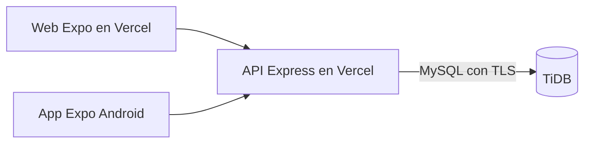

# ExpoTec — TiDB y Vercel

Decisión del usuario del 14/10/2026: base de datos en TiDB y frontend/backend como dos proyectos separados en Vercel. TiDB ya está configurado con `expotec`, sus migraciones y un usuario limitado para la aplicación. La prueba SQL completa pasó en una base independiente `expotec_test_01`. La publicación de los dos proyectos Vercel se prepara por separado.

El código activo de la web sigue siendo `frontend/native`, exportado mediante React Native Web. `frontend/web` conserva el prototipo anterior como referencia. La API atenderá ambos clientes cuando se conecten sus pantallas; actualmente conservan la demostración local.

## 1. Base en TiDB

Crear el clúster y la base `expotec`. Copiar host, puerto, usuario completo y contraseña desde **Connect** a `backend/.env`. Mantener TLS y verificación de certificado activados; usar `DB_SSL_CA` si hace falta indicar un PEM. Aplicar las migraciones desde una máquina autorizada con `npm run db:check` y `npm run db:migrate` dentro de `backend`.

La API usa un usuario con SELECT, INSERT, UPDATE y DELETE exclusivamente en `expotec`. Las migraciones y la preparación cargan las credenciales de administración de `.env.setup`; ese archivo no se publica. No compartir credenciales con el frontend. El clúster está en São Paulo (`sa-east-1`); configurar el backend de Vercel en `gru1` cuando esté disponible.

## 2. Proyecto backend en Vercel

Importar el repositorio y seleccionar **Root Directory: `backend`**, framework **Express**, Node **24.x**. Vercel reconoce `src/app.mjs`, que exporta la app y reutiliza un pool de conexiones por instancia. No ejecutar migraciones como Build Command.

Configurar variables exclusivamente en este proyecto:

| Variable | Valor |
| --- | --- |
| `NODE_ENV` | `production` |
| `JWT_SECRET` | secreto aleatorio, mínimo 32 bytes; mantenerlo entre despliegues |
| `CORS_ORIGINS` | origen HTTPS exacto del frontend; varios separados por coma |
| `DB_HOST`, `DB_PORT`, `DB_USER`, `DB_PASSWORD`, `DB_NAME` | datos del clúster y base `expotec` |
| `DB_SSL` | `true` |
| `DB_SSL_CA` | opcional, certificado PEM; admite `\n` escapados |
| `DB_POOL_LIMIT` | `5`, valor inicial por instancia; ajustar según conexiones observadas |

No cargar `TEST_DB_NAME` en producción. No copiar `.env` al repositorio. El puerto lo administra Vercel; `PORT=3001` corresponde al desarrollo local. La API limita los cuerpos de estas rutas a 16 KB y no implementa carga de archivos.

Tras publicar, comprobar POST `/api/health` y POST `/api/health/ready` con cuerpo `{}`. El primer endpoint solo indica que el servicio responde; el segundo comprueba una consulta a la base. Registrar la cuenta propia y promoverla con el script local `admin:grant`, sin crear credenciales de demostración en producción.

## 3. Proyecto frontend en Vercel

Importar el mismo repositorio como otro proyecto y seleccionar **Root Directory: `frontend/native`**, Node **24.x**. `vercel.json` establece build `npm run export:web`, salida `dist` y reescritura de las rutas a la entrada de la aplicación.

El frontend todavía no consume la API; no necesita variables para TiDB ni secretos. En el hito de integración se agregará la URL pública de la API y el manejo de sesión. Publicar ahora muestra el prototipo con datos locales de ejemplo.

## Entornos de prueba y archivos

Mantener base y secretos de prueba separados de producción. Los previews de Vercel requieren sus orígenes exactos en `CORS_ORIGINS` y deben apuntar a una base de prueba; no habilitar comodines para todos los dominios `vercel.app`.

Una API desplegada en funciones no debe conservar fotos, videos, copias de descargas ni sesiones en archivos locales. Las sesiones y límites de acceso de esta etapa se guardan en TiDB. La elección del servicio para imágenes/videos/descargas permanece pendiente.

## Fuentes verificadas

- [Express en Vercel](https://vercel.com/docs/frameworks/backend/express): detección de la aplicación y exportación de Express.
- [Pools de conexiones en Vercel](https://vercel.com/kb/guide/connection-pooling-with-functions): reutilización y cierre de conexiones ociosas.
- [Publicación web de Expo](https://docs.expo.dev/guides/publishing-websites/): exportación y configuración para Vercel.
- [TLS de TiDB Cloud](https://docs.pingcap.com/tidbcloud/secure-connections-to-serverless-clusters/): conexión segura y certificados.

## Estado del hito 7A

| Entregable | Estado |
| --- | --- |
| API de cuentas, sesiones, permisos y protección del último administrador | Implementada; 18 pruebas locales aprobadas |
| SQL de autenticación y migraciones repetibles | Aplicado a expotec y comprobado contra TiDB |
| Configuración de exportación web y dos proyectos Vercel | Preparada; typecheck y exportación web aprobados; publicación pendiente |
| Prueba completa MySQL/TiDB de concurrencia y restricciones | Aprobada en expotec_test_01 el 14/10/2026 |
| Pantallas conectadas, dominio ExpoTec y acceso social/recuperación | Próximos bloques de la etapa 7 |

Antes de dar por terminada esta etapa de infraestructura falta publicar y comprobar los proyectos Vercel. El APK continúa postergado por indicación del usuario.
