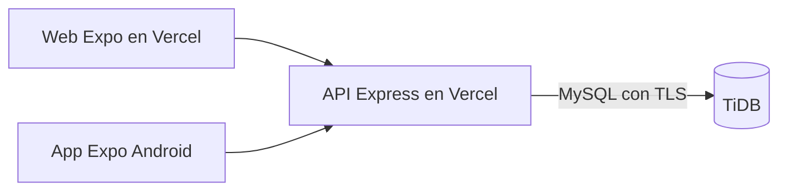

# ExpoTec — TiDB y Vercel

Decisión del usuario del 14/10/2026: base de datos en TiDB y frontend/backend como dos proyectos separados en Vercel. Los tres servicios están configurados y comprobados. TiDB tiene `expotec`, sus migraciones y un usuario limitado para la aplicación. La prueba SQL completa pasó en una base independiente `expotec_test_01`.

## Direcciones y prueba rápida

- Web pública: [ExpoTec](https://expotec-web-gn19.vercel.app).
- Base de la API: `https://expotec-api-gn19.vercel.app`.
- Panel del backend: [expotec-api en Vercel](https://vercel.com/gn19/expotec-api).
- Panel de la web: [expotec-web en Vercel](https://vercel.com/gn19/expotec-web).

Abrir la web permite probar la demostración. Para comprobar la API desde PowerShell:

```powershell
Invoke-RestMethod -Uri "https://expotec-api-gn19.vercel.app/api/health/ready" -Method Post -ContentType "application/json" -Body '{}'
```

La respuesta esperada es `status: ok` y `database: connected`. La API usa POST para sus consultas: abrir esa ruta o la raíz de la API directamente en el navegador hace una petición GET y devuelve 404.

En esta computadora, los archivos privados ya están preparados. Para trabajar localmente, abrir dos terminales desde la carpeta de ExpoTec: en `backend`, ejecutar `npm run dev`; en `frontend/native`, ejecutar `npm run web`. Para comprobar el código, ejecutar `npm test` en backend y `npm run typecheck` en frontend/native. Las pantallas conservan datos locales hasta completar la integración.

Los proyectos están conectados a `NachoTorress/PDeISC`, con **Production Branch: `main`**. Por indicación del usuario del 15/10/2026, trabajar, hacer commits y pushear directamente en `main`, sin crear ramas. Publicar cambios en `main` dispara los despliegues. El repositorio está en la carpeta superior `PDelSC`; incluir únicamente los cambios de ExpoTec y conservar los cambios locales de los otros proyectos.



El código activo de la web sigue siendo `frontend/native`, exportado mediante React Native Web. `frontend/web` conserva el prototipo anterior como referencia. **Mi cuenta** utiliza la API desde el hito 7B y **Espacios compartidos** desde el hito 7C. **Proyectos de ExpoTec** utiliza la API desde el hito 7D. El inventario y las reservas usan la API desde el hito 7E. Los préstamos y las devoluciones usan la API desde el hito 7F. La presentación TV compartida utiliza la API desde 7G; su demostración permanece separada.

## 1. Base en TiDB

La base `expotec` y las migraciones ya existen. Para preparar otra instalación, copiar `.env.example` a `.env` y `.env.setup.example` a `.env.setup`, completar las credenciales privadas y ejecutar `npm run db:setup`, `npm run db:migrate` y `npm run db:check` dentro de `backend`. No reemplazar los archivos privados de esta computadora por los ejemplos. Mantener TLS y verificación de certificado activados; usar `DB_SSL_CA` si hace falta indicar un PEM.

La API usa un usuario con SELECT, INSERT, UPDATE y DELETE exclusivamente en `expotec`. Las migraciones y la preparación cargan las credenciales de administración de `.env.setup`; ese archivo no se publica. No compartir credenciales con el frontend. El clúster está en São Paulo (`sa-east-1`); configurar el backend de Vercel en `gru1` cuando esté disponible.

## 2. Proyecto backend en Vercel

El proyecto `expotec-api` usa **Root Directory: `Proyecto Final - ExpoTec/backend`**, framework **Express**, Node **24.x**. Vercel reconoce `src/app.mjs`, que importa Express directamente, exporta la app y reutiliza un pool de conexiones por instancia. No ejecutar migraciones como Build Command.

Configurar variables exclusivamente en este proyecto:

| Variable | Valor |
| --- | --- |
| `NODE_ENV` | `production` |
| `JWT_SECRET` | secreto aleatorio, mínimo 32 bytes; mantenerlo entre despliegues |
| `CORS_ORIGINS` | origen HTTPS exacto del frontend; varios separados por coma |
| `DB_HOST`, `DB_PORT`, `DB_USER`, `DB_PASSWORD`, `DB_NAME` | datos del clúster y base `expotec` |
| `DB_SSL` | `true` |
| `DB_SSL_CA` | opcional, certificado PEM; admite `\n` escapados |
| `DB_POOL_LIMIT` | `5`, valor inicial por instancia; ajustar según conexiones observadas |

Las diez variables necesarias ya están guardadas como secretos de Production en Vercel, incluyendo la contraseña del usuario limitado y el JWT generado. No cargar `TEST_DB_NAME` ni credenciales de administración en producción. No copiar `.env` al repositorio. El puerto lo administra Vercel; `PORT=3001` corresponde al desarrollo local. La API limita los cuerpos de autenticación a 16 KB, proyectos a 64 KB y espacios a 128 KB; no implementa carga de archivos.

Tras publicar, comprobar POST `/api/health` y POST `/api/health/ready` con cuerpo `{}`. El primer endpoint solo indica que el servicio responde; el segundo comprueba una consulta a la base. Registrar la cuenta propia y promoverla con el script local `admin:grant`, sin crear credenciales de demostración en producción.

## 3. Proyecto frontend en Vercel

El proyecto `expotec-web` importa el mismo repositorio con **Root Directory: `Proyecto Final - ExpoTec/frontend/native`**, Node **24.x** y framework **Other**. `vercel.json` establece build `npm run export:web`, salida `dist` y reescritura de las rutas a la entrada de la aplicación.

El frontend consume la API de cuentas mediante una reescritura de `/api/:path*` a `https://expotec-api-gn19.vercel.app/api/:path*`, antes de la ruta general de Expo. Dejar `EXPO_PUBLIC_API_URL` sin definir en Vercel para usar este proxy. Esto mantiene la cookie de renovación en el mismo origen de la web, evitando depender de cookies entre dominios. El backend sigue desplegándose en su propio proyecto. No necesita cambios de esquema ni nuevas variables privadas.

La cookie de producción es HttpOnly, Secure y SameSite=Strict, sin Domain. El frontend solo recibe el token de acceso en memoria. Los endpoints `/api/auth/browser/*` exigen Origin autorizado y JSON; el proxy debe conservar el Origin de la web. Para un frontend alojado en otra dirección, agregar ese origen exacto a `CORS_ORIGINS` de la API. Los previews requieren la misma configuración y una API de pruebas.

Para desarrollo con Expo Web, copiar `.env.example` de `frontend/native` a `.env.local` si no existe y configurar la API en el mismo hostname, por ejemplo `http://localhost:3001`; abrir el frontend también con `localhost`. Autorizar en el backend su origen y puerto exactos. Reiniciar Expo al cambiar la variable. La vista previa de la exportación incluye un proxy a `http://127.0.0.1:3001`, configurable mediante `API_PROXY_URL`. En Android, sin variable se utiliza la API pública; un emulador puede apuntar a `http://10.0.2.2:3001`. Expo SecureStore conserva la renovación; el empaquetado no sustituye su comprobación en un teléfono.

Después de publicar, comprobar POST `/api/health/ready` a través del dominio de la web y el formulario **Mi cuenta**. Un refresh sin cookie debe responder 401 y eliminar la cookie; Origin ausente o ajeno debe dar 403. No crear cuentas ficticias en la base de producción para las pruebas.

## Entornos de prueba y archivos

Mantener base y secretos de prueba separados de producción. Los previews de Vercel requieren sus orígenes exactos en `CORS_ORIGINS` y deben apuntar a una base de prueba; no habilitar comodines para todos los dominios `vercel.app`.

Una API desplegada en funciones no debe conservar fotos, videos, copias de descargas ni sesiones en archivos locales. Las sesiones y límites de acceso de esta etapa se guardan en TiDB. La elección del servicio para imágenes/videos/descargas permanece pendiente.

## Fuentes verificadas

- [Express en Vercel](https://vercel.com/docs/frameworks/backend/express): detección de la aplicación y exportación de Express.
- [Pools de conexiones en Vercel](https://vercel.com/kb/guide/connection-pooling-with-functions): reutilización y cierre de conexiones ociosas.
- [Publicación web de Expo](https://docs.expo.dev/guides/publishing-websites/): exportación y configuración para Vercel.
- [TLS de TiDB Cloud](https://docs.pingcap.com/tidbcloud/secure-connections-to-serverless-clusters/): conexión segura y certificados.

## Estado del hito 7A

| Entregable | Estado |
| --- | --- |
| API de cuentas, sesiones, permisos y protección del último administrador | Implementada; 18 pruebas locales aprobadas |
| SQL de autenticación y migraciones repetibles | Aplicado a expotec y comprobado contra TiDB |
| Exportación web y dos proyectos Vercel | Publicados; typecheck y exportación web aprobados |
| Prueba completa MySQL/TiDB de concurrencia y restricciones | Aprobada en expotec_test_01 el 14/10/2026 |
| API pública conectada a TiDB | POST health y ready devuelven 200; ready confirma database: connected |
| Acceso público y CORS | Sesión sin token devuelve 401; preflight de la web devuelve 204; origen ajeno devuelve 403 |
| Pantallas de cuentas conectadas y persistencia de sesión | Implementadas en el hito 7B; pruebas en navegador local aprobadas |
| Dominio ExpoTec y acceso social/recuperación | Próximos bloques de la etapa 7 |

El hito 7A de infraestructura queda comprobado el 14/10/2026. El hito 7B del 19/10/2026 incorpora el acceso desde la aplicación: 20 pruebas de backend y 57 de frontend aprobadas, revisión de tipos y estilos y exportaciones web y Android comprobadas. En navegador local se verificaron registro, contraseña incorrecta, ingreso, recarga, renovación en dos pestañas, cierre con confirmación, tamaño de teléfono y tema oscuro.

## Espacios compartidos — hito 7C

La migración aditiva `002_spaces.sql` se aplicó a TiDB el 19/10/2026. Crea `spaces`, `furniture` y `booths`, vinculados mediante claves foráneas. No carga ejemplos ni modifica usuarios. Para otra instalación, ejecutar `npm run db:migrate` antes de publicar la API. Las tablas nuevas pueden conservarse si se vuelve al código anterior.

La web abre la consulta pública de espacios; solo una cuenta real con permiso de administrador puede crear, acomodar y dar de baja espacios. Las bajas conservan filas e identidades. El guardado del plano y la habilitación de puestos son atómicos y comprueban la versión. La API admite hasta 100 espacios activos y 150 elementos por plano. El listado devuelve resúmenes y cada plano se consulta por separado para limitar el tamaño de las respuestas.

Comprobaciones: 23 pruebas de backend y 60 de frontend aprobadas, más una prueba de integración real en TiDB (`npm run test:spaces`). Esa integración verifica migraciones repetibles, permisos, restricciones relacionales, guardados simultáneos y conservación de historial; utiliza y limpia únicamente sus propios datos en una base `expotec_test_*`. En navegador contra esa base se comprobaron creación, incorporación de una mesa, habilitación de puesto, giro, guardado, lectura desde otra pestaña, conflicto con borrador conservado, descarte confirmado, baja y consulta como invitado. La vista de 390 px no desborda horizontalmente.

Tras desplegar, POST `/api/spaces/query` con `{}` debe responder 200 y mostrar exclusivamente los espacios reales activos. Una base sin espacios devuelve `{ "spaces": [] }`. POST `/api/spaces/create` sin Bearer debe responder 401. Los espacios de demostración siguen separados; no importar datos ficticios a producción. Las confirmaciones de proyectos se incorporan en el hito 7D. El inventario y las reservas se incorporan en 7E; los préstamos compartidos se incorporan en 7F. Por indicación del usuario, Android se retoma al final.

Referencias de la persistencia de sesión: [Expo SecureStore](https://docs.expo.dev/versions/v57.0.0/sdk/securestore/), [cookies HTTP](https://developer.mozilla.org/en-US/docs/Web/HTTP/Guides/Cookies) y [reescrituras de Vercel](https://vercel.com/docs/rewrites).

## Proyectos compartidos — hito 7D

La migración aditiva `003_projects.sql` se aplicó en producción el 19/10/2026 antes del despliegue de la API. Crea proyectos, integrantes, profesores, materias y sus relaciones, asignaciones únicas de puesto e historial de revisión. No carga cuentas ni proyectos de ejemplo. No se necesitan nuevas variables privadas. Mantener las tablas si se revierte la aplicación.

Las propuestas se presentan con cuentas de alumnos; un profesor asignado pide cambios o confirma el puesto. La confirmación comprueba participantes, roles y disponibilidad dentro de una transacción. Los puestos con propuestas vigentes no se pueden retirar del plano. Reabrir o cancelar conserva el historial y libera una asignación confirmada. Las reservas de recursos se incorporan en 7E y los préstamos en 7F.

Comprobaciones automáticas: 26 pruebas de backend y 62 de frontend, más dos integraciones reales aprobadas (`test:spaces` y `test:projects`) en una base exclusiva `expotec_test_*`. La integración de proyectos cubre equipos, privacidad, permisos, correcciones, reenvío, dos aprobaciones simultáneas para un puesto, versiones, reapertura, cancelación y protección del plano. Android queda para el final, sin exportación nueva en este hito.

En navegador contra esa base se verificó la presentación con dos cuentas de alumnos y un profesor, protección del borrador al salir, pedido de cambios, edición y reenvío por otro integrante, confirmación, actualización del puesto en el plano y apertura de su ficha pública. La propuesta pendiente permaneció fuera de la muestra. Se comprobó también la consulta sin sesión y la vista de teléfono.

Después de publicar, comprobar POST `/api/projects/public/query` con `{}`: debe devolver 200 y exclusivamente proyectos confirmados, o `{ "projects": [] }` si todavía no hay. POST `/api/projects/query` y `/api/projects/create` sin Bearer deben responder 401. La ficha pública de un proyecto pendiente debe devolver 404. Los datos de prueba se crean y limpian únicamente en la base de pruebas.

## Inventario y reservas — hito 7E

La migración aditiva `004_inventory.sql` se aplicó en producción el 19/10/2026 antes del despliegue. Crea elementos, pedidos, reservas e historial de modificaciones con claves foráneas. No agrega existencias ni ejemplos a producción. No requiere variables nuevas. Conservar tablas y registros al revertir el código; una reversión anterior a 7E deja de gestionar reservas y debe evitarse mientras se sigan confirmando proyectos con elementos.

El catálogo de elementos exige cuenta de alumno, profesor, préstamos o administración. El inventario completo y el historial requieren préstamos o administración; solo administración escribe. Los invitados no acceden. POST `/api/inventory/query`, `/api/inventory/catalog/query` y `/api/inventory/create` sin Bearer deben devolver 401. Las propuestas admiten pedidos opcionales y la confirmación reserva todos los elementos junto con la mesa en una transacción. La ficha pública no expone pedidos, reservas ni datos de inventario.

Comprobaciones automáticas: 28 pruebas de backend y 64 de frontend aprobadas, más tres integraciones TiDB (`test:spaces`, `test:projects` y `test:inventory`). La prueba de inventario usa y limpia exclusivamente sus registros en una base `expotec_test_*`: cubre permisos, historial, versiones, bajas, faltantes sin reservas parciales, confirmaciones concurrentes y reducción de stock simultánea, reapertura y cancelación. El cliente anterior que omite pedidos al guardar los conserva. Se verificaron tipos, lint y exportación web; Android sigue al final.

En navegador contra esa base se comprobó alta de un elemento con dos unidades, pedido de tres con aviso de faltante, rechazo de confirmación, corrección a dos y reserva conjunta con el puesto. Se verificaron rechazo de reducción por debajo de las reservas, aumento de total con historial, baja bloqueada mientras existía un proyecto vigente, reapertura con liberación de stock, cancelación y baja conservando historial. El borrador del elemento pide confirmación al descartarlo y la vista de inventario se deshabilita durante la edición. La revisión móvil de 390 px no mostró desborde horizontal.

Desde 7F, la disponibilidad para reservar descuenta también unidades fuera de servicio. Las entregas y devoluciones físicas y sus protecciones se describen a continuación.


## Préstamos y devoluciones — hito 7F

La migración aditiva `005_loans.sql` se aplicó en producción el 19/10/2026 antes del despliegue. Crea `loans`, `loan_returns`, `resource_conditions` e `inventory_condition_events`, vinculadas mediante claves foráneas a proyectos, cuentas, recursos e historial. Para otra instalación, aplicar `npm run db:migrate` antes de publicar la API; no carga ejemplos ni altera las filas de las migraciones anteriores. No requiere variables nuevas. Conservar tablas y movimientos; no volver a una API anterior a 7F mientras haya préstamos pendientes, porque perdería las protecciones de stock y proyectos.

Solo préstamos y administración consultan o registran entregas, devoluciones y novedades. Las tres jornadas son ordinales: no representan fechas inventadas de la exposición. Cada movimiento registra fecha y hora UTC reales. Las devoluciones no liberan las reservas del proyecto, y los pendientes de todos los días limitan las entregas siguientes. Los daños actualizan inventario e historial en la misma transacción. Un ajuste administrativo permite reparar parcialmente y exige motivo al cambiar unidades fuera de servicio.

Comprobaciones automáticas del 19/10/2026: 30 pruebas de backend y 66 de frontend aprobadas, más cuatro integraciones TiDB (`test:spaces`, `test:projects`, `test:inventory`, `test:loans`). La integración de préstamos cubre tres jornadas, permisos, integrantes, entregas y devoluciones simultáneas, duplicados, versiones, saldos parciales, novedades sin devolución, daños, reparación parcial y protección de reapertura, cancelación y bajas. Limpia únicamente sus propios registros en una base `expotec_test_*`. Tipos, lint y exportación web comprobados; Android se mantiene al final.

En navegador contra la base de pruebas se verificaron entrega de tres unidades por una cuenta de préstamos, saldo al cambiar de jornada, devolución parcial, novedad con explicación, devolución con daño, actualización e historial del inventario, reparación por administración con motivo y una entrega de dos unidades en la jornada siguiente, respetando el saldo anterior. Se completaron ambas devoluciones y se comprobó el historial y la habilitación de cancelación al quedar sin pendientes. La vista móvil de 390 px no desborda. Los ejemplos temporales se retiran de la base de pruebas al terminar; no se crean cuentas ni movimientos ficticios en producción.

Después de publicar, comprobar POST `/api/health/ready` tanto en la API como a través de la web: 200 y `database: connected`. POST `/api/loans/query`, `/api/loans/projects/query`, `/api/loans/deliver` y `/api/loans/:id/return` sin Bearer deben devolver 401. La muestra pública debe seguir respondiendo 200 y omitir inventario y préstamos. La presentación TV compartida se incorpora en 7G; archivos, accesos sociales, recuperación y entrega final siguen pendientes.


## Presentación TV compartida — hito 7G

El endpoint público POST `/api/projects/presentation/query` entrega páginas de hasta 100 proyectos confirmados, con cursor UUID y solo información pública. Las relaciones se leen por lotes; no se requieren cambios de esquema, nuevas variables ni credenciales adicionales. La web se abre desde **Presentación TV** en espacios o proyectos, sin cuenta. La presentación local de demostración conserva sus datos separados.

Verificación del hito: 32 pruebas de backend y 69 de frontend aprobadas, tipos, lint y exportación web. Integración real `test:presentation` con TiDB: paginación de una ficha por página, exclusión de pendientes y cancelados, privacidad y retirada tras reapertura y cancelación. Regresión `test:projects` aprobada. Las integraciones usan y limpian solo sus registros en la base de pruebas. Las cuatro integraciones de dominio de 7F conservan sus resultados históricos; no se afirman nuevas ejecuciones de esas cuatro en este hito.

En navegador, con datos temporales en TiDB de pruebas, se comprobaron acceso público, ficha con imagen, avance automático, pausa, anterior/siguiente, video válido con sonido opcional y avance al terminar con las fichas configuradas a 30 segundos, video no disponible con ficha y reintento, pantalla completa con salida, temas claro y oscuro, actualización automática al retirar un proyecto, consulta fallida con pausa y secuencia oculta, recuperación manual y estado vacío tras cancelar los confirmados. El reproductor web captura el rechazo de reproducción automática y ofrece continuar sin sonido; el bloqueo específico del navegador queda condicionado a su política. Android y la prueba en teléfono físico siguen al final.

Después de publicar, verificar POST `/api/health/ready` y `/api/projects/presentation/query` tanto en la API como a través de la web: deben responder 200, conexión activa y secuencia sin ejemplos. Un cuerpo con `status: pending` o cursor inválido debe dar 400. Las rutas de préstamos y de proyectos privados deben seguir dando 401 sin sesión. Conservar ambas versiones compatibles al revertir: volver a una web anterior es posible, pero la nueva web necesita el endpoint 7G. No revertir a una API anterior a 7F mientras existan préstamos abiertos.

La vista de teléfono se comprobó en una ventana local de contenido de 390 × 844 píxeles: ficha, imagen y controles adaptados, sin desborde horizontal. No sustituye una prueba en Android físico. La revisión de dependencias y los avisos preexistentes de las herramientas Expo están en [DEPENDENCIAS.md](DEPENDENCIAS.md).

El archivo `docs/diagramas/sistema-expotec.drawio` documenta arquitectura, proyectos, préstamos y TV; incluye referencias al código, distinción de Android pendiente y vistas PNG/SVG generadas localmente. Su validación XML no reemplaza las pruebas del sistema.

Fuentes técnicas: [Fullscreen API](https://developer.mozilla.org/en-US/docs/Web/API/Element/requestFullscreen) para activación mediante un gesto del usuario y [video de Expo](https://docs.expo.dev/versions/latest/sdk/video/) para la base nativa. La web de TV usa un elemento de video con promesa de reproducción controlada; no carga reproductores externos embebidos.

## Usuarios y permisos — hito 7H (21/10/2026)

Mi cuenta incluye Usuarios y permisos únicamente para administradores reales. Se agregan POST `/api/admin/users/:id/query` y `/api/admin/users/:id/roles/save`; el listado existente admite `search`. No se requieren migraciones, variables nuevas ni proveedores externos. Publicar la API antes o junto con la web; los clientes anteriores conservan sus rutas.

Comprobaciones: 35 pruebas de backend, 71 de frontend, tipos, lint y exportación web. `npm run test:users` pasó contra TiDB en la base exclusiva de pruebas: búsqueda literal, páginas, permisos, privacidad, cambios visibles en sesiones ya abiertas y dos ediciones simultáneas con un único guardado correcto. La protección del último administrador y del actor que pierde permisos se verifica también en las pruebas del repositorio.

En navegador se comprobaron ingreso con cuenta ficticia, búsqueda por correo, asignación de profesor, revisión y confirmación, estado guardado, error de conflicto conservando la selección, descarte y recarga con confirmación, bloqueo de selección vacía y protección al volver atrás. La vista de 390 × 844 no desborda horizontalmente. Las cuentas de la comprobación son temporales en la base de pruebas; no se modifican permisos de cuentas reales. La prueba web no sustituye la comprobación en Android, que permanece postergada.

Después de publicar, verificar que web y API correspondan al mismo commit, que POST `/api/health/ready` responda 200 con base conectada y que las tres rutas administrativas den 401 sin sesión. Archivos, recuperación y Google/Discord/GitHub continúan pendientes de configuración y comprobación reales.

## Galería e invitados — hito 7I (21/10/2026)

Aplicar `npm run db:migrate` con las credenciales administrativas locales antes de publicar. La migración 006 agrega el rol guest y las tablas gallery_photos/gallery_reviews; no convierte ni modifica cuentas existentes. No requiere variables nuevas, alojamiento de archivos ni servicios externos. La web nueva incorpora accountType al registro, galería pública, aportes propios y moderación administrativa.

Verificación: 37 pruebas de backend y 72 de frontend, tipos, lint y exportación web. `test:gallery` pasó en TiDB de pruebas: alta como invitado sin permisos de alumno, aislamiento de aportes, proyección pública sin datos privados, aprobación/rechazo simultáneos, historial único por versión, retiro, motivo visible al autor, permisos retirados, paginación y dos envíos compitiendo por la última plaza pendiente. Se corrigió el conteo para utilizar una lectura bloqueada actual de TiDB. Regresión `test:users` aprobada. Las pruebas limpian solo sus cuentas y datos temporales.

En navegador contra TiDB de pruebas se comprobó registro de invitado, vista previa, aporte pendiente, exclusión de la consulta pública, aprobación con confirmación, publicación, retiro con motivo obligatorio y consulta del mensaje desde la cuenta autora. La vista pública de 390 × 844 no desborda horizontalmente y se revisaron los temas claro y oscuro. La evidencia usa una imagen de prueba, no una foto real de la exposición. Android sigue postergado y estas verificaciones no sustituyen la prueba en un teléfono físico.

Tras publicar, comprobar que ambos despliegues corresponden al commit nuevo; POST `/api/gallery/public/query` debe responder 200, sin ejemplos importados automáticamente. Las rutas mine/query, submit y moderation/query deben responder 401 sin sesión. El filtro público status debe rechazarse con 400. La galería se refresca al consultar, no transmite cambios en tiempo real.
