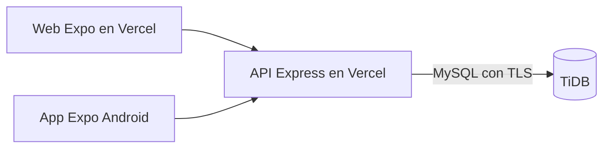

# ExpoTec — TiDB y Vercel

Decisión del usuario del 14/10/2026: base de datos en TiDB y frontend/backend como dos proyectos separados en Vercel. Los tres servicios están configurados y comprobados. TiDB tiene `expotec`, sus migraciones y un usuario limitado para la aplicación. La prueba SQL completa pasó en una base independiente `expotec_test_01`.

## Direcciones y prueba rápida

- Web pública: [ExpoTec](https://expotec-web-gn19.vercel.app).
- Base de la API: `https://expotec-api-gn19.vercel.app`.
- Panel del backend: [expotec-api en Vercel](https://vercel.com/gn19/expotec-api).
- Panel de la web: [expotec-web en Vercel](https://vercel.com/gn19/expotec-web).

Abrir la web permite probar la demostración. Para comprobar la API desde PowerShell:

```powershell
Invoke-RestMethod -Uri "https://expotec-api-gn19.vercel.app/api/health/ready" -Method Post -ContentType "application/json" -Body '{}'
```

La respuesta esperada es `status: ok` y `database: connected`. La API usa POST para sus consultas: abrir esa ruta o la raíz de la API directamente en el navegador hace una petición GET y devuelve 404.

En esta computadora, los archivos privados ya están preparados. Para trabajar localmente, abrir dos terminales desde la carpeta de ExpoTec: en `backend`, ejecutar `npm run dev`; en `frontend/native`, ejecutar `npm run web`. Para comprobar el código, ejecutar `npm test` en backend y `npm run typecheck` en frontend/native. Las pantallas conservan datos locales hasta completar la integración.

Los proyectos están conectados a `NachoTorress/PDeISC`, con **Production Branch: `main`**. Por indicación del usuario del 15/10/2026, trabajar, hacer commits y pushear directamente en `main`, sin crear ramas. Publicar cambios en `main` dispara los despliegues. El repositorio está en la carpeta superior `PDelSC`; incluir únicamente los cambios de ExpoTec y conservar los cambios locales de los otros proyectos.



El código activo de la web sigue siendo `frontend/native`, exportado mediante React Native Web. `frontend/web` conserva el prototipo anterior como referencia. **Mi cuenta** utiliza la API desde el hito 7B y **Espacios compartidos** desde el hito 7C. Los proyectos, inventario y préstamos continúan en la demostración local.

## 1. Base en TiDB

La base `expotec` y las migraciones ya existen. Para preparar otra instalación, copiar `.env.example` a `.env` y `.env.setup.example` a `.env.setup`, completar las credenciales privadas y ejecutar `npm run db:setup`, `npm run db:migrate` y `npm run db:check` dentro de `backend`. No reemplazar los archivos privados de esta computadora por los ejemplos. Mantener TLS y verificación de certificado activados; usar `DB_SSL_CA` si hace falta indicar un PEM.

La API usa un usuario con SELECT, INSERT, UPDATE y DELETE exclusivamente en `expotec`. Las migraciones y la preparación cargan las credenciales de administración de `.env.setup`; ese archivo no se publica. No compartir credenciales con el frontend. El clúster está en São Paulo (`sa-east-1`); configurar el backend de Vercel en `gru1` cuando esté disponible.

## 2. Proyecto backend en Vercel

El proyecto `expotec-api` usa **Root Directory: `Proyecto Final - ExpoTec/backend`**, framework **Express**, Node **24.x**. Vercel reconoce `src/app.mjs`, que importa Express directamente, exporta la app y reutiliza un pool de conexiones por instancia. No ejecutar migraciones como Build Command.

Configurar variables exclusivamente en este proyecto:

| Variable | Valor |
| --- | --- |
| `NODE_ENV` | `production` |
| `JWT_SECRET` | secreto aleatorio, mínimo 32 bytes; mantenerlo entre despliegues |
| `CORS_ORIGINS` | origen HTTPS exacto del frontend; varios separados por coma |
| `DB_HOST`, `DB_PORT`, `DB_USER`, `DB_PASSWORD`, `DB_NAME` | datos del clúster y base `expotec` |
| `DB_SSL` | `true` |
| `DB_SSL_CA` | opcional, certificado PEM; admite `\n` escapados |
| `DB_POOL_LIMIT` | `5`, valor inicial por instancia; ajustar según conexiones observadas |

Las diez variables necesarias ya están guardadas como secretos de Production en Vercel, incluyendo la contraseña del usuario limitado y el JWT generado. No cargar `TEST_DB_NAME` ni credenciales de administración en producción. No copiar `.env` al repositorio. El puerto lo administra Vercel; `PORT=3001` corresponde al desarrollo local. La API limita los cuerpos de autenticación a 16 KB y los de espacios a 128 KB; no implementa carga de archivos.

Tras publicar, comprobar POST `/api/health` y POST `/api/health/ready` con cuerpo `{}`. El primer endpoint solo indica que el servicio responde; el segundo comprueba una consulta a la base. Registrar la cuenta propia y promoverla con el script local `admin:grant`, sin crear credenciales de demostración en producción.

## 3. Proyecto frontend en Vercel

El proyecto `expotec-web` importa el mismo repositorio con **Root Directory: `Proyecto Final - ExpoTec/frontend/native`**, Node **24.x** y framework **Other**. `vercel.json` establece build `npm run export:web`, salida `dist` y reescritura de las rutas a la entrada de la aplicación.

El frontend consume la API de cuentas mediante una reescritura de `/api/:path*` a `https://expotec-api-gn19.vercel.app/api/:path*`, antes de la ruta general de Expo. Dejar `EXPO_PUBLIC_API_URL` sin definir en Vercel para usar este proxy. Esto mantiene la cookie de renovación en el mismo origen de la web, evitando depender de cookies entre dominios. El backend sigue desplegándose en su propio proyecto. No necesita cambios de esquema ni nuevas variables privadas.

La cookie de producción es HttpOnly, Secure y SameSite=Strict, sin Domain. El frontend solo recibe el token de acceso en memoria. Los endpoints `/api/auth/browser/*` exigen Origin autorizado y JSON; el proxy debe conservar el Origin de la web. Para un frontend alojado en otra dirección, agregar ese origen exacto a `CORS_ORIGINS` de la API. Los previews requieren la misma configuración y una API de pruebas.

Para desarrollo con Expo Web, copiar `.env.example` de `frontend/native` a `.env.local` si no existe y configurar la API en el mismo hostname, por ejemplo `http://localhost:3001`; abrir el frontend también con `localhost`. Autorizar en el backend su origen y puerto exactos. Reiniciar Expo al cambiar la variable. La vista previa de la exportación incluye un proxy a `http://127.0.0.1:3001`, configurable mediante `API_PROXY_URL`. En Android, sin variable se utiliza la API pública; un emulador puede apuntar a `http://10.0.2.2:3001`. Expo SecureStore conserva la renovación; el empaquetado no sustituye su comprobación en un teléfono.

Después de publicar, comprobar POST `/api/health/ready` a través del dominio de la web y el formulario **Mi cuenta**. Un refresh sin cookie debe responder 401 y eliminar la cookie; Origin ausente o ajeno debe dar 403. No crear cuentas ficticias en la base de producción para las pruebas.

## Entornos de prueba y archivos

Mantener base y secretos de prueba separados de producción. Los previews de Vercel requieren sus orígenes exactos en `CORS_ORIGINS` y deben apuntar a una base de prueba; no habilitar comodines para todos los dominios `vercel.app`.

Una API desplegada en funciones no debe conservar fotos, videos, copias de descargas ni sesiones en archivos locales. Las sesiones y límites de acceso de esta etapa se guardan en TiDB. La elección del servicio para imágenes/videos/descargas permanece pendiente.

## Fuentes verificadas

- [Express en Vercel](https://vercel.com/docs/frameworks/backend/express): detección de la aplicación y exportación de Express.
- [Pools de conexiones en Vercel](https://vercel.com/kb/guide/connection-pooling-with-functions): reutilización y cierre de conexiones ociosas.
- [Publicación web de Expo](https://docs.expo.dev/guides/publishing-websites/): exportación y configuración para Vercel.
- [TLS de TiDB Cloud](https://docs.pingcap.com/tidbcloud/secure-connections-to-serverless-clusters/): conexión segura y certificados.

## Estado del hito 7A

| Entregable | Estado |
| --- | --- |
| API de cuentas, sesiones, permisos y protección del último administrador | Implementada; 18 pruebas locales aprobadas |
| SQL de autenticación y migraciones repetibles | Aplicado a expotec y comprobado contra TiDB |
| Exportación web y dos proyectos Vercel | Publicados; typecheck y exportación web aprobados |
| Prueba completa MySQL/TiDB de concurrencia y restricciones | Aprobada en expotec_test_01 el 14/10/2026 |
| API pública conectada a TiDB | POST health y ready devuelven 200; ready confirma database: connected |
| Acceso público y CORS | Sesión sin token devuelve 401; preflight de la web devuelve 204; origen ajeno devuelve 403 |
| Pantallas de cuentas conectadas y persistencia de sesión | Implementadas en el hito 7B; pruebas en navegador local aprobadas |
| Dominio ExpoTec y acceso social/recuperación | Próximos bloques de la etapa 7 |

El hito 7A de infraestructura queda comprobado el 14/10/2026. El hito 7B del 19/10/2026 incorpora el acceso desde la aplicación: 20 pruebas de backend y 57 de frontend aprobadas, revisión de tipos y estilos y exportaciones web y Android comprobadas. En navegador local se verificaron registro, contraseña incorrecta, ingreso, recarga, renovación en dos pestañas, cierre con confirmación, tamaño de teléfono y tema oscuro.

## Espacios compartidos — hito 7C

La migración aditiva `002_spaces.sql` se aplicó a TiDB el 19/10/2026. Crea `spaces`, `furniture` y `booths`, vinculados mediante claves foráneas. No carga ejemplos ni modifica usuarios. Para otra instalación, ejecutar `npm run db:migrate` antes de publicar la API. Las tablas nuevas pueden conservarse si se vuelve al código anterior.

La web abre la consulta pública de espacios; solo una cuenta real con permiso de administrador puede crear, acomodar y dar de baja espacios. Las bajas conservan filas e identidades. El guardado del plano y la habilitación de puestos son atómicos y comprueban la versión. La API admite hasta 100 espacios activos y 150 elementos por plano. El listado devuelve resúmenes y cada plano se consulta por separado para limitar el tamaño de las respuestas.

Comprobaciones: 23 pruebas de backend y 60 de frontend aprobadas, más una prueba de integración real en TiDB (`npm run test:spaces`). Esa integración verifica migraciones repetibles, permisos, restricciones relacionales, guardados simultáneos y conservación de historial; utiliza y limpia únicamente sus propios datos en una base `expotec_test_*`. En navegador contra esa base se comprobaron creación, incorporación de una mesa, habilitación de puesto, giro, guardado, lectura desde otra pestaña, conflicto con borrador conservado, descarte confirmado, baja y consulta como invitado. La vista de 390 px no desborda horizontalmente.

Tras desplegar, POST `/api/spaces/query` con `{}` debe responder 200 y mostrar exclusivamente los espacios reales activos. Una base sin espacios devuelve `{ "spaces": [] }`. POST `/api/spaces/create` sin Bearer debe responder 401. Los espacios de demostración siguen separados; no importar datos ficticios a producción. Las confirmaciones de proyectos y el inventario y préstamos compartidos quedan para los siguientes hitos. Por indicación del usuario, Android se retoma al final.

Referencias de la persistencia de sesión: [Expo SecureStore](https://docs.expo.dev/versions/v57.0.0/sdk/securestore/), [cookies HTTP](https://developer.mozilla.org/en-US/docs/Web/HTTP/Guides/Cookies) y [reescrituras de Vercel](https://vercel.com/docs/rewrites).
