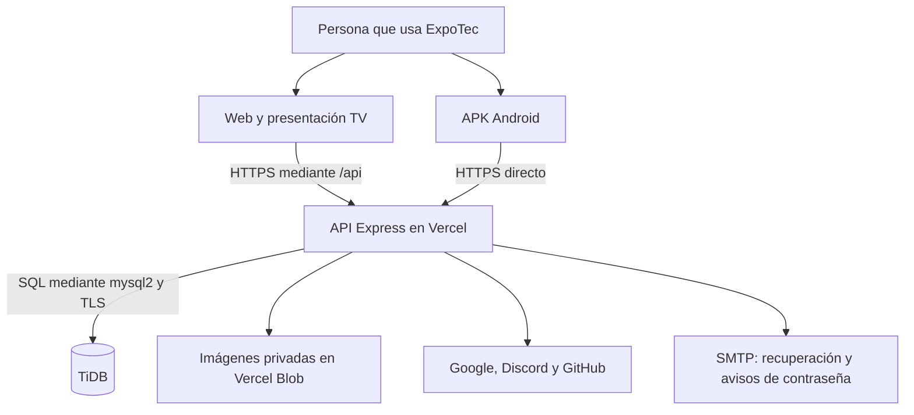
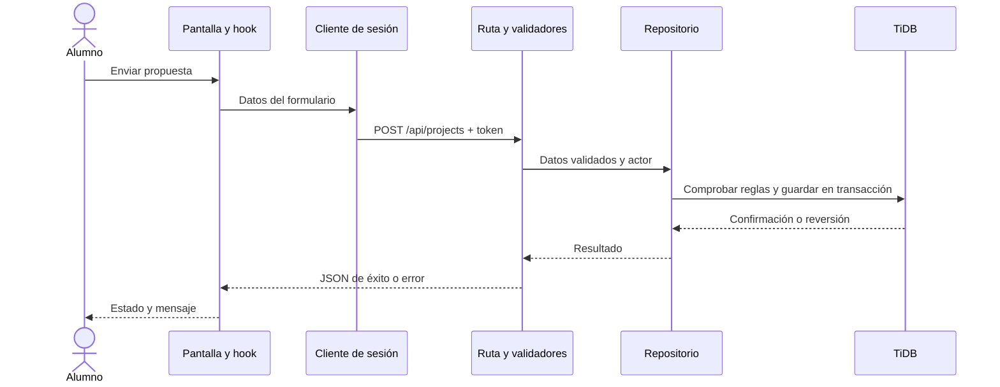
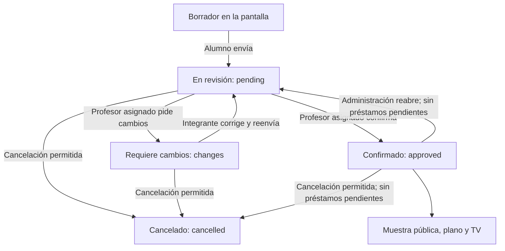
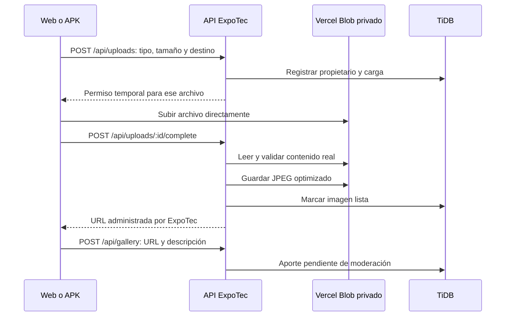
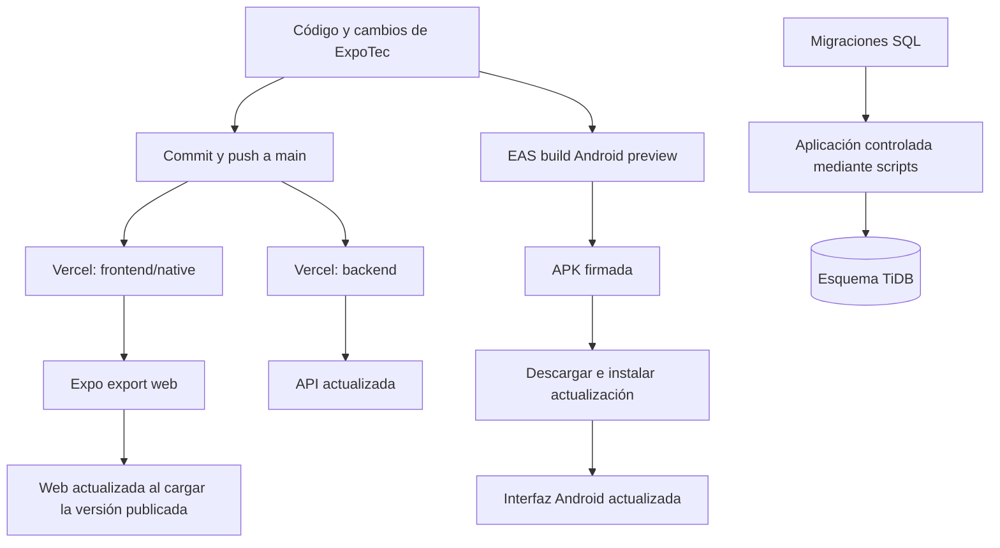
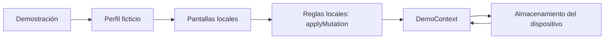

# Cómo funciona ExpoTec, de la pantalla a la base de datos

Guía del código revisada el 3 de noviembre de 2026. Los modelos técnicos actualizados son el [DFD y DER](DFD_Y_DER.md), disponibles en [el visor de diagramas](diagramas/modelos-datos.html). Los once recorridos de esta guía son explicaciones de funcionamiento; sus esquemas anteriores se conservan como material complementario.

## 1. El mapa general

ExpoTec tiene dos formas de abrir la misma aplicación: desde el navegador y desde una APK instalada en Android. Ambas usan el código de `frontend/native`. La versión de navegador se construye con React Native Web; la de Android se compila con Expo/EAS.

| Pieza | Para qué sirve | Dónde está |
| --- | --- | --- |
| Frontend | Pantallas, navegación, formularios, mensajes y sesión del dispositivo. | `frontend/native/src/` |
| Web | Exportación del frontend que se abre por una URL. También muestra el modo TV. | `frontend/native/dist/`, generado; despliegue Vercel `expotec-web`. |
| APK | Paquete instalable con el frontend compilado para Android. | Configuración en `frontend/native/app.json` y `eas.json`; binario distribuido desde EAS. |
| Backend o API | Autenticación, permisos, reglas compartidas y operaciones con la base. | `backend/src/`; despliegue Vercel `expotec-api`. |
| TiDB | Usuarios, sesiones, planos, proyectos, reservas, préstamos e historiales. | Esquema definido en `backend/sql/`. |
| Blob | Archivos de imágenes. TiDB guarda la relación, propietario, estado y URL. | `backend/src/services/uploads.mjs`. |
| Servicios externos | Identidad social y correo de recuperación. EAS construye los paquetes Android. | Servicios del backend y configuración de Expo. |

La carpeta `frontend/web` conserva un prototipo anterior. El frontend que se mantiene y publica está en `frontend/native`.

La APK contiene la interfaz, recursos incluidos y código del dispositivo. La base y el servidor funcionan aparte: las operaciones compartidas necesitan conexión con la API. El modo TV es una pantalla del frontend; no constituye otro servidor.

## 2. Qué ocurre cuando tocás un botón

Ejemplo: un alumno envía una propuesta.

1. La pantalla recoge el formulario y muestra errores de campo si falta información.
2. El hook prepara el pedido. En la propuesta, `useSharedProposal` coordina los pasos, el borrador y los envíos.
3. El cliente de API obtiene una sesión válida y manda JSON por HTTPS. Las operaciones autenticadas incluyen el token de acceso.
4. Express aplica las protecciones comunes: origen, tamaño del cuerpo y formato. La ruta exige sesión y los límites de solicitudes que correspondan.
5. Los validadores del backend revisan de nuevo los datos. La validación de la pantalla ayuda a la persona; la del servidor determina qué acepta el sistema.
6. El repositorio vuelve a comprobar los permisos y reglas de negocio que corresponden a la operación. No alcanza con que el botón esté visible.
7. Si hay varios cambios relacionados, se ejecutan dentro de una transacción en TiDB. Se confirman juntos o se revierten juntos.
8. La API devuelve JSON. La pantalla actualiza su estado o muestra el error conservando el borrador cuando corresponde.

Las consultas de datos de esta API usan **POST con cuerpo JSON**. Crear también usa POST; modificar usa PUT o PATCH según el recurso; cancelar, dar de baja o eliminar usa DELETE. El significado de DELETE depende de cada dominio: cancelar un proyecto conserva historial, mientras eliminar una foto borra su registro y revisiones.

Hay excepciones GET para la documentación, los retornos OAuth y la entrega de imágenes publicadas. La regla de las consultas POST no impide que el navegador descargue HTML, JavaScript e imágenes normalmente.

Los errores contienen código, mensaje, campos cuando corresponda e identificador de solicitud. Ejemplos: 400 datos inválidos, 401 sesión inválida, 403 falta de permiso, 404 recurso no visible, 409 conflicto de versión o disponibilidad, 429 exceso de intentos y 503 servicio no disponible. El código de error precisa la causa.

**Seguirlo en el código:** [cliente](../frontend/native/src/lib/authClient.ts), [transporte HTTP](../frontend/native/src/lib/authRequest.ts), [armado de Express](../backend/src/create-app.mjs), [rutas de proyectos](../backend/src/routes/projects.mjs), [repositorio](../backend/src/repositories/projects.mjs) y [transacciones](../backend/src/config/database.mjs).

## 3. Acceso, sesión y permisos

Al abrir la app, `AuthProvider` intenta recuperar la sesión. La persona también puede consultar las secciones públicas sin ingresar.

### Correo y contraseña

El registro permite crear una cuenta de alumno o invitado. La API valida los datos y almacena la contraseña mediante un hash con sal; no guarda la contraseña en texto. Al ingresar, verifica la contraseña y emite una sesión.

La sesión tiene dos piezas:

| Pieza | Función | Dónde se conserva |
| --- | --- | --- |
| Token de acceso | Autoriza las llamadas durante 15 minutos. | Memoria del cliente. |
| Token de renovación | Permite obtener acceso nuevo; la sesión tiene una duración de hasta 30 días. Se rota al renovar. | Cookie HttpOnly en web; SecureStore en Android. En TiDB se guarda un hash del token de renovación. |

El cliente renueva el acceso antes de que venza y puede reintentar una llamada una vez tras un 401. Coordina las operaciones de sesión para evitar renovar simultáneamente con el mismo token. Al volver a primer plano, comprueba la sesión y actualiza los roles.

Cerrar sesión revoca la sesión correspondiente y olvida el estado local. Tener el menú abierto o una pantalla cargada no concede permisos: el backend comprueba la cuenta y sus roles vigentes.

### Acceso social y recuperación

- **Google, Discord y GitHub:** el proveedor verifica la identidad. El backend valida la respuesta y completa el ingreso, alta o vinculación que corresponda. ExpoTec emite su propia sesión; el proveedor no reemplaza los permisos de ExpoTec. Google dispone de selección nativa en Android; los otros recorridos usan navegador y retorno a web o app.
- **Olvidé mi contraseña:** se solicita un correo. La respuesta no revela si la cuenta existe. El enlace es de un solo uso y vence a los 20 minutos. Completar el cambio revoca las sesiones y exige volver a ingresar.

### Quién puede hacer qué

Una cuenta puede tener varios roles. El visitante sin cuenta no es lo mismo que una cuenta con rol invitado.

| Perfil | Recorrido principal |
| --- | --- |
| Visitante sin cuenta | Consulta espacios, proyectos confirmados, galería aprobada y TV. |
| Invitado con cuenta | Además puede enviar fotos y consultar sus aportes. |
| Alumno | Presenta y corrige propuestas de su equipo; pide puesto y elementos. También puede aportar fotos. |
| Profesor | Revisa las propuestas en las que figura como profesor asignado. |
| Encargado de préstamos | Consulta inventario y registra entregas, devoluciones y novedades. |
| Administrador | Gestiona usuarios y permisos, espacios, inventario y moderación de fotos; también puede operar préstamos y reabrir proyectos. Confirmar un proyecto requiere ser profesor asignado, aunque la cuenta tenga administración. |

**Fuentes:** [AuthContext](../frontend/native/src/contexts/AuthContext.tsx), [cliente de sesión](../frontend/native/src/lib/authClient.ts), [servicio de autenticación](../backend/src/services/auth.mjs), [criptografía](../backend/src/services/crypto.mjs), [rutas](../backend/src/routes/auth.mjs), [acceso social](../backend/src/services/social.mjs) y [recuperación](../backend/src/services/recovery.mjs).

## 4. El ciclo completo de un proyecto

El alumno completa cuatro etapas: datos del proyecto, equipo y materias, puesto y elementos, y revisión final. Los integrantes y profesores son cuentas registradas. El creador y quien edita deben permanecer en el equipo según las comprobaciones del servidor.

**Pedir no equivale a reservar.** Una propuesta pendiente solicita un puesto y cantidades de elementos. Al confirmar, el servidor verifica equipo, profesores, puesto habilitado y stock; asigna el puesto y reserva todos los elementos en la misma transacción. Si falta algo, no confirma parcialmente.

Un integrante puede corregir una propuesta pendiente o con cambios solicitados. La propuesta corregida vuelve a revisión. Un proyecto confirmado se publica con su información pública; sus pedidos, reservas e historial privado no se incluyen en esa ficha pública.

Administración puede reabrir un confirmado. Reabrir o cancelar libera puesto y reservas, pero conserva el historial. Si quedan unidades sin devolver, primero se exige registrar su devolución. Una cancelación no borra físicamente la fila del proyecto.

Cada edición o decisión incluye una `version`. Si dos personas trabajan con versiones diferentes, la API rechaza la operación desactualizada con un conflicto. Así se evita que un guardado antiguo tape una decisión más reciente.

**Fuentes:** [formulario compartido](../frontend/native/src/pages/SharedProposalPage.tsx), [hook](../frontend/native/src/hooks/useSharedProposal.ts), [ficha y revisión](../frontend/native/src/pages/SharedProjectPage.tsx), [reglas de proyectos](../backend/src/repositories/projects.mjs) y [reservas](../backend/src/repositories/inventory.mjs).

## 5. Espacios, planos e inventario

Administración crea un espacio y acomoda elementos en su plano. El mobiliario describe mesas, bancos, zonas o referencias eléctricas. Una mesa habilitada como puesto puede ser solicitada por un proyecto.

El plano guarda posiciones relativas y la consulta pública permite seleccionar un puesto para ver su disponibilidad o abrir el proyecto confirmado. Guardar un plano comprueba versiones y relaciones; no permite quitar puestos que tengan propuestas vigentes. Las referencias eléctricas del plano requieren la revisión de personal habilitado.

El inventario representa tipos de elementos y cantidades: por ejemplo, proyectores o sillas. Administración modifica existencias y unidades fuera de servicio con sus observaciones; préstamos y administración consultan el detalle e historial. El catálogo reducido está disponible a los perfiles autorizados para las propuestas.

| Concepto | Qué significa |
| --- | --- |
| Total | Cantidad registrada del elemento. |
| Fuera de servicio | Cantidad que no se puede usar por daño o revisión. |
| Reservado | Cantidad comprometida con proyectos confirmados. |
| Sin devolver | Cantidad físicamente entregada que todavía no volvió. |
| Disponible para reservar | Máximo entre cero y total menos fuera de servicio menos reservas. |
| Disponible físicamente para entregar | Máximo entre cero y total menos fuera de servicio menos unidades sin devolver. |

**Ejemplo:** hay 10 sillas, 2 fuera de servicio y 6 reservadas. Quedan 2 para nuevas reservas. Si de esas 6 reservadas solo se entregaron 4, hay 4 utilizables físicamente en el depósito; parte de ellas ya está comprometida. Para una entrega, el sistema verifica tanto la reserva del proyecto como la disponibilidad física.

**Fuentes:** [espacios](../frontend/native/src/hooks/useSharedSpaces.ts), [repositorio de planos](../backend/src/repositories/spaces.mjs), [inventario](../backend/src/repositories/inventory.mjs) y [migración de espacios](../backend/sql/002_spaces.sql).

## 6. Entregas, jornadas, devoluciones y daños

1. El encargado elige jornada 1, 2 o 3 y un proyecto confirmado con reservas.
2. Selecciona el elemento, una cantidad permitida y el alumno integrante que retira.
3. El servidor comprueba permiso, versión del proyecto, reserva, stock físico y saldos sin devolver.
4. Registra la entrega con fecha, operador y destinatario. Se admite una entrega por proyecto, elemento y jornada, aunque después se devuelva.
5. La devolución puede ser total o parcial. El saldo es lo entregado menos lo devuelto.
6. Si vuelve una unidad dañada, cuenta como devuelta y queda fuera de servicio en el inventario. Se registra la observación y el evento correspondiente.
7. Administración puede registrar el cambio de condición tras la revisión o reparación del elemento.

Cambiar de jornada no cierra préstamos. Un saldo pendiente de ayer sigue contando hoy y reduce lo que el proyecto puede retirar. Devolver los elementos no cancela la reserva del proyecto: reserva y entrega física son registros distintos.

**Fuentes:** [pantalla](../frontend/native/src/pages/SharedLoansPage.tsx), [formulario de entrega](../frontend/native/src/components/SharedLendingForm.tsx), [devolución](../frontend/native/src/components/SharedReturnForm.tsx), [repositorio de préstamos](../backend/src/repositories/loans.mjs) y [saldos](../backend/src/repositories/loan-balances.mjs).

## 7. Fotos: archivo, aporte, moderación y eliminación

Hay que distinguir el **archivo de imagen** del **aporte de galería**. Subir un archivo todavía no lo publica.

Se admiten JPG, PNG y WebP de hasta 10 MB en la carga compartida. El backend valida el contenido real y lo convierte a JPEG de hasta 1600 píxeles por lado y 2 MB. El permiso temporal de subida no entrega al dispositivo la credencial permanente de almacenamiento.

También se puede usar un enlace HTTPS admitido por el formulario. En ese recorrido no se sube el archivo a Blob: se conserva la referencia externa.

El aporte de galería queda **pendiente**. Administración lo aprueba o rechaza; solo los aprobados se listan públicamente. La imagen administrada se entrega mediante la API cuando corresponde a una foto o proyecto publicado. Las vistas previas privadas comprueban quién tiene acceso.

Administración puede eliminar fotos pendientes, aprobadas o rechazadas. La operación comprueba la versión y borra el registro del aporte y sus revisiones. Eso retira la publicación y su acceso público administrado; no debe confundirse con un borrado inmediato del objeto físico en Blob. El repositorio de galería no ejecuta ese borrado del almacenamiento, y tampoco puede borrar el archivo de una URL externa.

La carga de imagen de un proyecto comparte el servicio de archivos, pero su publicación depende de la confirmación del proyecto. La demostración tiene su propio selector y límite local de 2 MB.

**Fuentes:** [cliente de carga](../frontend/native/src/lib/photoUpload.ts), [subida web](../frontend/native/src/lib/blobUpload.web.ts), [subida Android](../frontend/native/src/lib/blobUpload.ts), [servicio de imágenes](../backend/src/services/uploads.mjs), [control de visibilidad](../backend/src/repositories/uploads.mjs) y [galería](../backend/src/repositories/gallery.mjs).

## 8. Consulta pública y presentación TV

La muestra pública y TV usan proyectos confirmados. TV pide sus fichas por `POST /api/projects/presentation/query` y completa las páginas de la consulta antes de reproducir.

La preparación permite elegir 8, 15 o 30 segundos por imagen y configurar el sonido. Iniciar presentación abre un visor independiente a pantalla completa y arranca inmediatamente desde el primer proyecto. El visor oculta la navegación, muestra imágenes y textos grandes y esconde los controles durante la reproducción. Se puede pausar, retroceder, avanzar y salir con controles táctiles o con flechas, espacio y Esc en web. Las imágenes avanzan por tiempo y los videos al terminar. Si la plataforma no admite la pantalla completa del navegador, el visor ocupa toda la ventana.

TV vuelve a consultar cada minuto. Si falla la conexión, detiene la presentación y regresa a la preparación para actualizar y reintentar. La web y TV consultan datos actuales; no hay que reconstruir el frontend cada vez que se confirma un proyecto.

**Fuentes:** [pantalla TV](../frontend/native/src/pages/SharedPresentationPage.tsx), [lógica de presentación](../frontend/native/src/lib/sharedPresentation.ts) y [consulta pública](../backend/src/repositories/projects.mjs).

## 9. Cómo pasan los cambios a la web y a la APK

El código se conserva en el repositorio superior `PDelSC`, dentro de la carpeta de ExpoTec. Por instrucción del proyecto se trabaja y publica directamente en `main`. Frontend y backend tienen despliegues separados.

| Cambio | Qué hay que actualizar |
| --- | --- |
| Texto, botón, navegación o comportamiento del frontend | Publicar web; compilar y distribuir otra APK para que llegue a Android. |
| Regla o endpoint del backend | Publicar API. La web y las APK compatibles usan el nuevo servidor. Si cambia el contrato, revisar los clientes. |
| Tabla o columna de la base | Preparar y aplicar la migración compatible, coordinada con el código. Un push no ejecuta las migraciones automáticamente. |
| Proyecto, préstamo, stock o moderación desde la aplicación | Se guarda en TiDB; aparece al consultar o actualizar la sección correspondiente. No requiere otra compilación. |
| Secreto o servicio externo | Cambiar la configuración privada del servicio correspondiente y publicar cuando sea necesario. Nunca incluir secretos en el frontend o Git. |

En web, `/api` se reescribe desde el sitio hacia la API: el navegador usa el mismo origen. En la APK, la URL HTTPS de la API se incluye al construir el perfil `preview`. Las variables `EXPO_PUBLIC_*` son públicas y quedan en el paquete; no sirven para contraseñas ni claves privadas.

No hay un mecanismo de actualizaciones OTA de Expo configurado en este proyecto. Subir un cambio de interfaz a Git o Vercel no reemplaza el código de una APK ya instalada. Los cambios del servidor sí se reciben al comunicarse con una API compatible.

**Estado a esta fecha:** app configurada como 0.5.2, Android `versionCode` 8 y API 0.5.1. La APK distribuida de código 8 se generó antes de la auditoría funcional del 3 de noviembre: incluye la eliminación de fotos, pero no esas correcciones posteriores de interfaz. La web ya contiene las correcciones. El número de versión del archivo de configuración no identifica por sí solo qué commit contiene una APK ya construida.

**Fuentes:** [configuración Expo](../frontend/native/app.json), [perfiles EAS](../frontend/native/eas.json), [publicación web](../frontend/native/vercel.json), [armado de API](../backend/src/app.mjs), [APK disponible](APK_PRUEBA.md) y [auditoría](AUDITORIA_FUNCIONAL_2026-11-03.md).

## 10. La demostración es un circuito independiente

La opción Demostración carga personas, espacios y proyectos ficticios. Cambiar a Estudiante, Profesor u Organización dentro de ella cambia el perfil del ejemplo; no asigna ese rol a la cuenta real.

En web los datos de demostración se conservan mediante AsyncStorage sobre almacenamiento del navegador. En Android se usan archivos JSON con respaldo y compatibilidad con datos locales anteriores. No se sincronizan con TiDB ni con otro dispositivo.

La cuenta real puede seguir iniciada mientras se recorre la demostración. Eso no mezcla los datos: las pantallas compartidas usan `AuthContext` y la API; las de demostración usan `DemoContext` y su modelo local.

**Fuentes:** [raíz de la app](../frontend/native/src/app.tsx), [DemoContext](../frontend/native/src/contexts/DemoContext.tsx), [modelo local](../frontend/native/src/lib/model.ts), [persistencia web](../frontend/native/src/lib/demoStorage.web.ts) y [persistencia Android](../frontend/native/src/lib/demoStorage.native.ts).

## 11. Qué guarda la base y cómo leer el repositorio

| Grupo | Tablas principales | Conexión con los recorridos |
| --- | --- | --- |
| Identidad | `users`, `roles`, `user_roles`, `sessions`, `refresh_tokens` | Cuenta, permisos, persistencia y revocación de sesión. |
| Acceso externo | `social_providers`, `social_identities`, `social_flows`, `password_resets` | Acceso social y recuperación. |
| Espacios | `spaces`, `furniture`, `booths` | Lugar, plano y puestos habilitados. |
| Proyectos | `projects`, `project_members`, `project_teachers`, `subjects`, `project_subjects`, `project_reviews` | Propuesta, equipo, profesores, materias e historial. |
| Asignaciones | `booth_allocations`, `project_resource_requests`, `resource_allocations` | Diferencia entre puesto pedido/asignado y elementos pedidos/reservados. |
| Inventario | `resources`, `resource_conditions`, `inventory_events`, `inventory_condition_events` | Existencias, unidades no utilizables y motivos de cambio. |
| Préstamos | `loans`, `loan_returns` | Entrega física, destinatario, jornada y devoluciones. |
| Fotos | `image_uploads`, `gallery_photos`, `gallery_reviews` | Carga del archivo, aporte y moderación. |
| Control | `auth_rate_limits` y registro de migraciones | Límites de intentos y evolución del esquema. |

Las claves foráneas conectan estas entidades y las transacciones mantienen consistentes las operaciones relacionadas. Los archivos de imagen viven en Blob; las filas relacionadas y permisos viven en TiDB. Las credenciales de DB, firma de sesión, Blob, proveedores y SMTP pertenecen a la configuración privada del backend.

Para estudiar el código, seguir este orden:

1. [`app.tsx`](../frontend/native/src/app.tsx): contextos y estructura general.
2. [`RootStack.tsx`](../frontend/native/src/components/navigation/RootStack.tsx) y [`navigationItems.ts`](../frontend/native/src/components/navigation/navigationItems.ts): pantallas y menú por perfil.
3. Una pantalla `Shared*` y su hook: interacción concreta con datos compartidos. `AccountPage` y `AdminUsersPage` también usan la API aunque sus nombres no empiecen por Shared.
4. [`authClient.ts`](../frontend/native/src/lib/authClient.ts) y [`authRequest.ts`](../frontend/native/src/lib/authRequest.ts): sesión y transporte HTTP.
5. [`backend/src/app.mjs`](../backend/src/app.mjs) y [`create-app.mjs`](../backend/src/create-app.mjs): construcción de la API y sus dependencias.
6. `routes/` → `validators/` → `repositories/` y `services/`: entrada, validación, reglas y persistencia. Varias reglas de negocio y permisos finos están en los repositorios; no todo pasa por una capa de servicios.
7. [`backend/sql/`](../backend/sql/): estructura y restricciones de la base, mediante diez migraciones.
8. `test/` del backend y `*.test.ts` del frontend: ejemplos verificables de límites, permisos y resultados esperados. Los scripts de integración usan una base exclusiva de pruebas.

## Comprobación de esta guía

Se usaron Graphify para localizar relaciones del código, drawio-skill para los diagramas editables y documentación y ADRs para organizar la explicación. El grafo local analizó 367 archivos de código y produjo 1761 nodos y 6098 relaciones; sirve para orientarse, no reemplaza la lectura de las reglas. El extractor no procesó los SQL por falta del analizador opcional; las migraciones se revisaron directamente.

Los flujos simplifican el código para estudiarlo y conservan referencias a sus archivos. No son una nueva prueba de inicio de sesión social, correo o Android físico. Las últimas pruebas funcionales y sus límites están en [el informe de auditoría](AUDITORIA_FUNCIONAL_2026-11-03.md).
